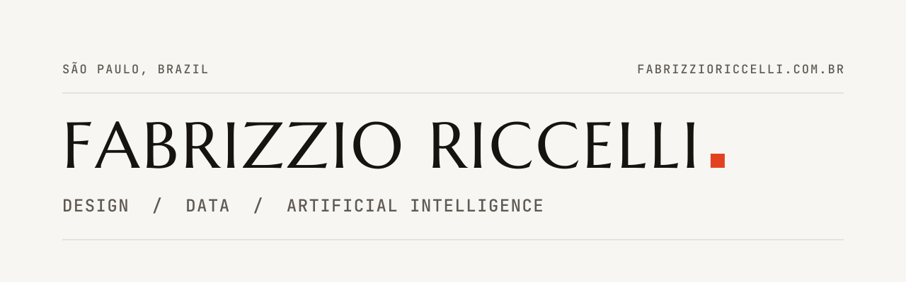

<picture>
  <source media="(prefers-color-scheme: dark)" srcset="assets/banner-dark.svg">
  
</picture>

**Data Analytics · Machine Learning · Artificial Intelligence · Business & Technology**

A background in graphic design and more than three years of experience at Santander Brasil (2023–2026), across marketing, growth and digital performance, provide a business-oriented foundation for technology.

Currently studying Artificial Intelligence at FIAP, with projects spanning data analytics, machine learning, process automation and digital products. The focus is on connecting analytical thinking, customer needs and business objectives to practical, measurable solutions.

[Portfolio](https://fabrizzioriccelli.com.br) · [LinkedIn](https://www.linkedin.com/in/fabrizzioriccelli/) · [Behance](https://www.behance.net/fabrizzioriccelli) · [Português](README.pt-BR.md)

## Areas of focus

- **Data Analytics & BI:** exploratory analysis, ETL, data quality, business indicators, dashboards and visualization.
- **Applied Machine Learning:** supervised learning, predictive analytics, baseline comparisons and model evaluation.
- **Development & Automation:** browser-based tools, data workflows, APIs and automated testing.
- **Business & Product:** marketing analytics, digital growth, financial services and user-centered product development.

## Selected projects

### Professional case

**[Emulador Report PF & PJ](https://github.com/fabrizzioriccelli/emulador-report-case)** · Reporting automation & marketing analytics · 2026

Browser-based editing of monthly performance reports with HTML and Outlook-ready email exports. JavaScript, IndexedDB, client-side MIME generation and 18 Playwright/Node test suites. Led the project from requirements and acceptance criteria to review and testing, including 41 reviewed pull requests. Independent public portfolio demonstration with fictional data; not an official Santander product.

### Academic projects · FIAP

**[Brisa](https://github.com/fabrizzioriccelli/brisa-heat-alert)** · Global Solution 2026.2 · Applied AI & IoT · Team project

Predictive heat-risk monitoring for public schools using Python, Random Forest, ESP32, SQLite and Streamlit. The team analyzed 263,040 real hourly meteorological records from five Brazilian capitals. Regression MAE of 1.33 °C versus a 1.85 °C baseline; classification accuracy of 83.6%. Technical contribution: data, models, firmware, backend and dashboard, with AI-assisted development.

**Frota Pulse** · Enterprise Challenge, FIAP × Sem Parar Empresas · Data pipelines & ML · Team project

[Sprint 1 — Specification](https://github.com/fabrizzioriccelli/frota-pulse-sprint-1) · [Sprint 2 — Implementation](https://github.com/fabrizzioriccelli/frota-pulse-sprint-2)

Fleet cost intelligence with Python: 75,413 simulated records, 12 heterogeneous input files, 17 data-quality rules and peer benchmarks. A decision tree achieved 82.8% accuracy on the vehicle-month test set versus a 73.6% baseline. Technical contribution: documentation, data workflows, implementation review and testing. All fleet data are synthetic; results demonstrate the method rather than actual customer outcomes.

**[FarmTech Solutions](https://github.com/fabrizzioriccelli/farmtech-solutions)** · Agricultural analytics · Team project

Python and R application for agricultural area and input calculations, statistical analysis, CSV data management and weather API integration. [Live prototype](https://farmtech-solutions-demo.vercel.app/dashboard).

### Independent & exploratory projects

**[Faro](https://github.com/fabrizzioriccelli/faro-real-estate-intelligence)** · Real estate market intelligence · In progress

Research and exploratory tooling for public housing-market data (HIS/HMP) in São Paulo, emphasizing traceability, data auditing and market analysis. The complete platform remains under development.

**[Personal portfolio](https://github.com/fabrizzioriccelli/portfolio)** · Web development & design systems

Static site generator using the Python standard library, vanilla JavaScript, WebGL and a strict content security policy. [Visit the portfolio](https://fabrizzioriccelli.com.br).

## Technical toolkit

| Domain | Tools & methods |
| --- | --- |
| Data & analytics | Python, SQL, R, pandas, NumPy, SQLite, Excel, Power BI, Jupyter, Streamlit, EDA, ETL, data quality |
| Machine learning | scikit-learn, Random Forest, decision trees, supervised learning, statistics, validation, error analysis |
| Development & automation | JavaScript, HTML, CSS, Git, GitHub, Playwright, APIs, IndexedDB |
| IoT & embedded systems | ESP32, C++ (Arduino), Wokwi |
| Business & product | Marketing analytics, CRM, growth, KPIs, digital performance, UX/UI, product discovery, design systems |
| Currently studying | Deep learning, NLP, generative AI |

Recent development uses AI coding agents, with personal contributions focused on problem framing, acceptance criteria, code review and testing. Project documentation identifies team contributions, real versus synthetic data and prototype limitations.

## Professional background

**Santander Brasil · 2023–2026** — Former Marketing Analyst, Digital Growth & Performance, following three internships within the bank. Experience in growth, branding, full-funnel campaigns, CRM, media, ASO, performance analysis and digital financial products. Selected initiatives include Santander Rewards, One App, Select Global, Conta para Menores, Tamo Junto, FastCo Money and Protocolo Alice. This background informs the understanding of customer needs, financial services and the business context behind technical decisions.

**ALS & Hanok Branding · 2022–2023** — Art direction, brand identity and visual communication, providing a foundation in design and user experience.

## Education

**FIAP** — Technologist degree in Artificial Intelligence · 2026–2028 (in progress)  
**Universidade Anhembi Morumbi** — Bachelor's degree in Graphic Design · 2022–2025

---

São Paulo, Brazil · [LinkedIn](https://www.linkedin.com/in/fabrizzioriccelli/) · [Portfolio](https://fabrizzioriccelli.com.br)
