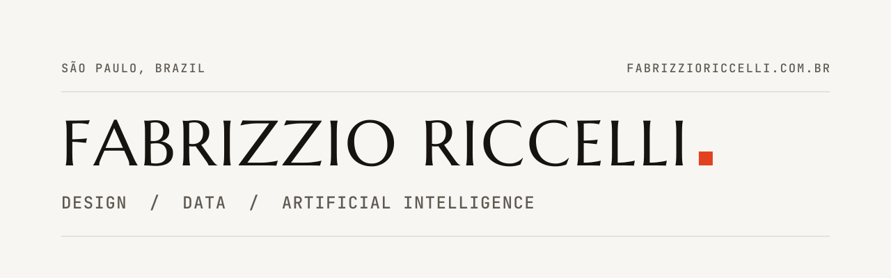

<picture>
  <source media="(prefers-color-scheme: dark)" srcset="assets/banner-dark.svg">
  
</picture>

**Data Analytics · Machine Learning · Inteligência Artificial · Negócios & Tecnologia**

Formação em Design Gráfico e mais de três anos de experiência no Santander Brasil (2023–2026), nas frentes de marketing, growth e performance digital, constituem uma base de negócios para a atuação em tecnologia.

Atualmente, em formação em Inteligência Artificial na FIAP, com projetos de análise de dados, machine learning, automação de processos e produtos digitais. O foco é conectar pensamento analítico, necessidades dos clientes e objetivos de negócio a soluções práticas e mensuráveis.

[Portfólio](https://fabrizzioriccelli.com.br) · [LinkedIn](https://www.linkedin.com/in/fabrizzioriccelli/) · [Behance](https://www.behance.net/fabrizzioriccelli) · [English](README.md)

## Áreas de atuação

- **Data Analytics & BI:** análise exploratória, ETL, qualidade de dados, indicadores de negócio, dashboards e visualização.
- **Machine Learning aplicado:** aprendizado supervisionado, análise preditiva, comparação com baselines e avaliação de modelos.
- **Desenvolvimento & automação:** ferramentas no navegador, fluxos de dados, APIs e testes automatizados.
- **Negócios & produto:** marketing analytics, growth, serviços financeiros e desenvolvimento de produtos centrados no usuário.

## Projetos selecionados

### Case profissional

**[Emulador Report PF & PJ](https://github.com/fabrizzioriccelli/emulador-report-case)** · Automação de relatórios & Marketing Analytics · 2026

Edição de relatórios mensais de performance no navegador e exportação em HTML e e-mail executivo compatível com Outlook. JavaScript, IndexedDB, geração de MIME no cliente e 18 suítes de testes em Playwright/Node. Condução do projeto dos requisitos e critérios de aceite à revisão e aos testes, incluindo 41 pull requests revisados. Demonstração pública independente de portfólio com dados fictícios; não é produto oficial do Santander.

### Projetos acadêmicos · FIAP

**[Brisa](https://github.com/fabrizzioriccelli/brisa-heat-alert)** · Global Solution 2026.2 · IA aplicada & IoT · Projeto em equipe

Monitoramento preditivo de risco térmico para escolas públicas com Python, Random Forest, ESP32, SQLite e Streamlit. A equipe analisou 263.040 registros meteorológicos horários reais de cinco capitais brasileiras. MAE de regressão de 1,33 °C contra 1,85 °C do baseline; acurácia de classificação de 83,6%. Contribuição técnica: dados, modelos, firmware, backend e dashboard, com desenvolvimento assistido por IA.

**Frota Pulse** · Enterprise Challenge FIAP × Sem Parar Empresas · Pipelines de dados & ML · Projeto em equipe

[Sprint 1 — Especificação](https://github.com/fabrizzioriccelli/frota-pulse-sprint-1) · [Sprint 2 — Implementação](https://github.com/fabrizzioriccelli/frota-pulse-sprint-2)

Inteligência de custos para frotas com Python: 75.413 registros simulados, 12 arquivos de origem heterogêneos, 17 regras de qualidade e benchmarks entre pares. Árvore de decisão com 82,8% de acurácia no conjunto de teste veículo-mês, contra 73,6% do baseline. Contribuição técnica: documentação, fluxos de dados, revisão da implementação e testes. Os dados de frotas são sintéticos; os resultados demonstram o método, não o desempenho de clientes reais.

**[FarmTech Solutions](https://github.com/fabrizzioriccelli/farmtech-solutions)** · Inteligência agrícola · Projeto em equipe

Aplicação em Python e R para cálculos de área e insumos, análise estatística, gestão de dados CSV e integração com API meteorológica. [Protótipo online](https://farmtech-solutions-demo.vercel.app/dashboard).

### Projetos independentes e exploratórios

**[Faro](https://github.com/fabrizzioriccelli/faro-real-estate-intelligence)** · Inteligência imobiliária · Em desenvolvimento

Pesquisa e ferramentas exploratórias para dados públicos do mercado de habitação (HIS/HMP) em São Paulo, com foco em rastreabilidade, auditoria de dados e análise de mercado. A plataforma completa permanece em desenvolvimento.

**[Portfólio pessoal](https://github.com/fabrizzioriccelli/portfolio)** · Desenvolvimento web & Design Systems

Gerador de site estático em Python com biblioteca padrão, JavaScript sem framework, WebGL e política de segurança de conteúdo estrita. [Acessar portfólio](https://fabrizzioriccelli.com.br).

## Competências técnicas

| Área | Ferramentas e métodos |
| --- | --- |
| Dados & Analytics | Python, SQL, R, pandas, NumPy, SQLite, Excel, Power BI, Jupyter, Streamlit, EDA, ETL, Data Quality |
| Machine Learning | scikit-learn, Random Forest, árvores de decisão, aprendizado supervisionado, estatística, validação, análise de erros |
| Desenvolvimento & automação | JavaScript, HTML, CSS, Git, GitHub, Playwright, APIs, IndexedDB |
| IoT & sistemas embarcados | ESP32, C++ (Arduino), Wokwi |
| Negócios & produto | Marketing Analytics, CRM, Growth, KPIs, performance digital, UX/UI, discovery de produto, Design Systems |
| Em formação | Deep Learning, NLP, IA Generativa |

O desenvolvimento recente utiliza agentes de programação com IA, com contribuição pessoal na definição de problemas, critérios de aceite, revisão de código e testes. A documentação dos projetos identifica contribuições em equipe, dados reais e sintéticos e limitações dos protótipos.

## Trajetória profissional

**Santander Brasil · 2023–2026** — Ex-Analista de Marketing, Digital Growth & Performance, após três estágios no banco. Experiência em growth, branding, campanhas full funnel, CRM, mídia, ASO, análise de performance e produtos financeiros digitais. Entre as iniciativas estão Santander Rewards, One App, Select Global, Conta para Menores, Tamo Junto, FastCo Money e Protocolo Alice. Essa trajetória fundamenta a compreensão das necessidades dos clientes, dos serviços financeiros e do contexto de negócio das decisões técnicas.

**ALS & Hanok Branding · 2022–2023** — Direção de arte, identidade de marca e comunicação visual, formando a base em design e experiência do usuário.

## Formação

**FIAP** — Tecnólogo em Inteligência Artificial · 2026–2028 (em andamento)  
**Universidade Anhembi Morumbi** — Bacharelado em Design Gráfico · 2022–2025

---

São Paulo, Brasil · [LinkedIn](https://www.linkedin.com/in/fabrizzioriccelli/) · [Portfólio](https://fabrizzioriccelli.com.br)
